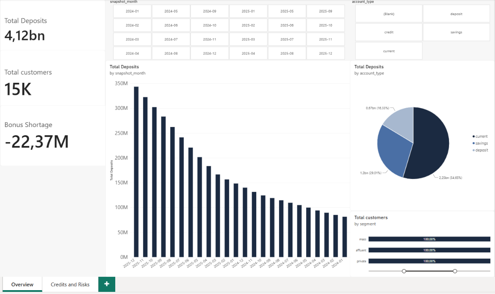
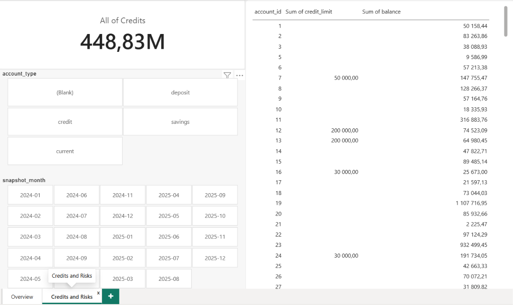

# 🏦 Commercial Bank Pre-Sale Due Diligence & Portfolio Audit

<p align="center">
  
  
  
  
  
</p>

This project simulates a comprehensive analytical audit of a commercial bank’s portfolio and operational health prior to a potential state acquisition (M&A Due Diligence). 
It demonstrates advanced SQL skills in financial data modeling, cohort analysis, risk assessment, and executive reporting, paired with an interactive Power BI dashboard.

---

📌 **Project Overview**

Prior to a potential acquisition of a commercial bank by a state-backed investor, an independent data-driven audit was conducted covering the period of **2023–2025**.  
The goal is to evaluate the bank's true financial health, uncover hidden client base risks, assess loan portfolio quality, and calculate outstanding liabilities (including loyalty program deficits) using PostgreSQL.

- **Dataset Scale:** 700,000+ transactions across 12 relational tables (Star Schema: `dim_*` and `fact_*`).
- **Tech Stack:** PostgreSQL (CTE, Window Functions, Complex Aggregations, Multi-table JOINs), Power BI (DAX, Executive Reporting).

---

### Project Goals & Analytical Blocks

- **Block 1 (`01_customers.sql`):** Analyze customer base growth, cohort retention, and hidden behavioral churn vs. official flags.
- **Block 2 (`02_balances.sql`):** Evaluate deposit balance dynamics, stability, and customer concentration risks.
- **Block 3 (`03_activity.sql`):** Investigate operational activity, transaction trends, digital channel adoption, and seasonal peaks.
- **Block 4 (`04_risks.sql`):** Assess operational risks, failure/decline rates, and fraud indicators (`is_fraud_flag`).
- **Block 5 (`05_credit.sql`):** Audit the credit portfolio, credit line utilization, and borrower over-indebtedness.
- **Block 6 (`06_bonus.sql`):** Calculate unredeemed bonus program liabilities and program efficiency.

---

📊 **Skills Demonstrated**

- **Advanced SQL Techniques:** Common Table Expressions (CTE), Window Functions (`NTILE`, `LAG`, `SUM() OVER ()`), conditional aggregation (`FILTER`, `CASE WHEN`), and multi-table `JOIN` operations.
- **Data Warehousing:** Working with relational Star Schema architecture (`dim_*` and `fact_*` tables).
- **Business & Financial Analysis:** M&A Due Diligence, liquidity risk assessment, cohort tracking, and risk exposure profiling.
- **Executive Reporting & BI:** Translating raw database queries into interactive Power BI dashboards and management insights (`REPORT.md`).

---

## 📊 Power BI Dashboard Preview

### 1. Overview & Customer Base


### 2. Credit Portfolio & Risk


---

### Repository Structure

```text
├── dashboard/
│   ├── page1.png              # Overview & Customer Base dashboard preview
│   └── page2.png              # Credit Portfolio & Risk dashboard preview
├── data/
│   └── schema.sql             # Database schema (Star Schema, 12 tables)
├── sql/                       # Modular SQL queries broken down into 6 analytical blocks
│   ├── 01_customers.sql       # Customer base growth and behavioral churn audit
│   ├── 02_balances.sql        # Deposit balances and liability concentration
│   ├── 03_activity.sql        # Transaction volumes, seasonality, and channels
│   ├── 04_risks.sql           # Decline rates, fraud indicators, and frozen assets
│   ├── 05_credit.sql          # Credit limits, utilization tiers, and borrower exposure
│   └── 06_bonus.sql           # Bonus points liability ledger and deficit analysis
├── REPORT.md                  # Comprehensive Executive Summary for stakeholders
└── README.md                  # Project overview and documentation
